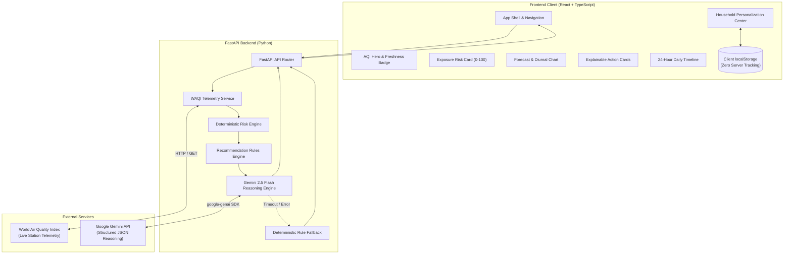
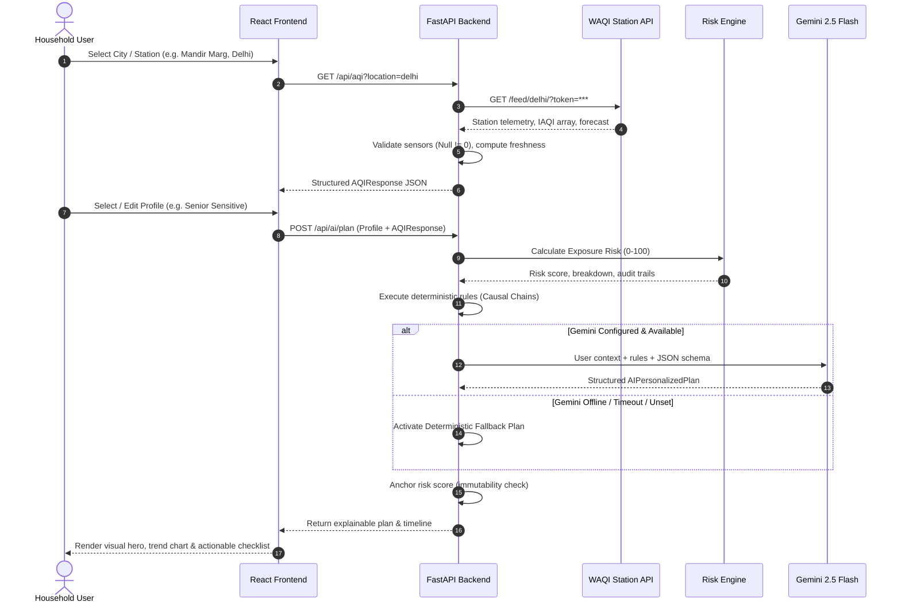

# VayuSense (वायुSense)
### Personalized Urban Environmental Intelligence & Exposure Risk Assistant

[](https://fastapi.tiangolo.com)
[](https://react.dev)
[](https://www.typescriptlang.org)
[](https://tailwindcss.com)
[](https://aistudio.google.com/)
[](https://pytest.org)

> **PromptWars Challenge 6 Submission**  
> **Live Demo:** [https://vayusense.app (Placeholder)](#)  
> **Repository:** [https://github.com/riyan/vayusense (Placeholder)](#)

---

## 1. Problem Statement

Across urban India, tens of millions of citizens wake up to hazardous air quality index (AQI) levels exceeding 200–400 during the winter smog months. Conventional air quality platforms (apps and weather portals) present a single, city-wide number and generic advice: *"Air quality is unhealthy. Avoid outdoor exertion."*

However, this one-size-fits-all paradigm fails in real life:
1. **Exposure is not uniform:** A healthy adult commuting inside an air-conditioned car has a radically different exposure profile than a delivery rider or two-wheeler commuter navigating bumper-to-bumper diesel exhaust for two hours.
2. **Vulnerabilities are asymmetric:** An ambient AQI of 140 is an inconvenience for a healthy runner, but a clinical emergency trigger for an asthmatic child or a senior citizen with COPD.
3. **Generic advice is impractical:** Working parents cannot simply "stay indoors." They need micro-timing adjustments, low-exposure commute alternatives, kitchen ventilation protocols during dinner preparation, and actionable routines that balance daily life with respiratory protection.
4. **Data opacity:** Most apps display synthetic numbers without reporting sensor freshness, scale methodology, or individual pollutant sub-indices, creating false reassurance or unwarranted panic.

---

## 2. Solution Overview

**VayuSense** transforms passive ambient air quality monitoring into **explainable, personalized environmental intelligence**. 

Instead of treating AQI as a static headline, VayuSense pairs **live atmospheric telemetry** from local monitoring stations with a **private household exposure profile**. 

The architecture strictly separates deterministic science from generative reasoning:
- **Deterministic Risk Engine (Python/Pydantic):** Calculates an audit-backed **0–100 VayuSense Exposure Risk Score** and deterministic protective rules grounded in atmospheric physics and human respiratory physiology.
- **Gemini 2.5 Flash Reasoning Engine:** Translates this deterministic foundation and the household’s specific daily schedule into time-sequenced routines, indoor source controls, and practical sustainable commute swaps.
- **Explainability Layer:** Every single recommendation features a transparent 5-stage causal chain:  
  $$\text{LIVE DATA} \longrightarrow \text{HOUSEHOLD CONTEXT} \longrightarrow \text{DETECTED RISK} \longrightarrow \text{ACTION} \longrightarrow \text{BENEFIT}$$

---

## 3. Key Features

### 🌐 Live Atmospheric Telemetry & Sensor Integrity
- **Real-Time Station Feeds:** Live station readings via the World Air Quality Index (WAQI) network covering Indian metropolitan stations (Delhi, Mumbai, Bengaluru, Kolkata, Lucknow, Jalandhar, etc.).
- **Zero Fabricated Readings:** Missing sensors remain strictly `null` (never converted to `0.0`). Missing AQI returns `None` rather than fabricated values.
- **Data Freshness Engine:** Categorizes telemetry into `Live (<1h)`, `Fresh (~2h)`, `Moderate (~4h)`, or `Stale (>6h)`. Stale data applies an explicit confidence penalty to the risk score.
- **Methodology Transparency:** Prominently explains that reported values utilize the **WAQI / US EPA Standard** breakpoint formula, and are not calibrated to the 24-hour CPCB National Air Quality Index (NAQI) sub-indices.
- **Multi-Day Telemetry Forecasts:** Renders multi-day forecast curves for $\text{PM}_{2.5}$, $\text{PM}_{10}$, and $\text{O}_3$ broadcast directly by station telemetry.
- **24-Hour Diurnal Ambient Model:** Models ground-level thermal boundary layer collapse (morning and evening smog peaks) vs midday solar convection windows.

### 🏠 Interactive Household Personalization
- **Three Selectable Demo Personas:**
  1. *Two-Wheeler Commuters:* 2 adults, 90-min daily commute via open two-wheeler, peak traffic exposure.
  2. *Family with Young Children:* 2 adults, 5-year-old child, after-school outdoor play, active kitchen prep.
  3. *Senior-Sensitive Household:* Senior occupant with asthma, daily morning walk, limited mobility.
- **Natural Language Profile Parser:** Type free-text descriptions (e.g., *"We are 2 adults in Delhi, my father has asthma, and I ride a scooter to work"*) — Gemini extracts structured fields with explicit user confirmation before applying.
- **Client-Side Privacy Architecture:** Household profiles and health sensitivities remain securely stored in browser `localStorage`. No personal data is stored in persistent tracking databases.

### 📊 Explainable Risk Engine & Causal Chains
- **0–100 Personalized Exposure Risk Score:** An explainable composite score combining base AQI, vulnerability multipliers, outdoor duration, diurnal timing, and indoor environmental factors.
- **5-Stage Causal Chains:** Every recommendation displays the exact data triggers, detected risks, and expected physiological benefits.
- **5-Dimension Qualitative Impact Ratings:** Rates actions across *Personal Exposure*, *Household Protection*, *Community Emissions*, *Practicality*, and *Cost*.
- **"What Changed?" Inspector:** An audit comparison drawer showing exactly which parameters shifted the risk score and triggered new rules when switching locations, profiles, or schedules.
- **Daily Actionable Checklist:** Morning, afternoon, evening, and night protective routines with real-time completion tracking persisted locally by date.

### 🛡️ Resilient Fail-Safe Operation & Isolated Demo Mode
- **Deterministic Fallback Guarantee:** If the Gemini API experiences network timeouts, quota exhaustion, or invalid responses, VayuSense immediately falls back to high-grade deterministic rule-based routines. The application never crashes.
- **Risk Anchor Immutability:** The AI model is strictly prohibited from overriding or recalculating the deterministic risk score.
- **Offline Demo Mode:** Evaluators can inspect labeled design fixtures independently with a prominent amber `DEMO DATA` banner, ensuring evaluation data is never mixed with live station readings.

---

## 4. Technology Stack

### Frontend Architecture
- **Framework:** React 18.3 + TypeScript 5.5
- **Build Tool:** Vite 6.4 (Hot module replacement, production code splitting)
- **Styling:** Tailwind CSS 3.4 (Custom editorial design system, responsive touch targets)
- **Visualizations:** Recharts 2.15 (Composed station forecast charts, diurnal area models)
- **Icons:** Lucide React (Accessible SVG iconography)
- **State & Storage:** Client-side custom hooks with TTL memory caching and `localStorage` persistence

### Backend Architecture
- **Framework:** FastAPI 0.115+ (Asynchronous ASGI Python web framework)
- **Runtime:** Python 3.11+ / 3.14 compatible
- **Type Validation & Schemas:** Pydantic v2 (Strict validation for models, requests, and outputs)
- **HTTP Client:** HTTPX 0.28 (Asynchronous HTTP connection pooling with strict timeouts)
- **AI Engine:** Google GenAI SDK (`google-genai` / Gemini 2.5 Flash) with structured JSON schema constraints
- **Test Suite:** Pytest + Pytest-AsyncIO + Node Test Runner (101 backend tests plus frontend unit, concurrency, accessibility, and contrast suites)

---

## 5. System Architecture



---

## 6. Live Data Flow



---

## 7. Deterministic Risk Engine Methodology

The VayuSense Exposure Risk Score is a **continuous 0 to 100 index** calculated deterministically using the following formula:

$$\text{Exposure Risk} = \text{Clamp}_{0}^{100}\left( \left(\text{Base AQI Component} \times \text{Vulnerability Factor}\right) + S_{\text{duration}} + S_{\text{timing}} + S_{\text{indoor}} + P_{\text{freshness}} \right)$$

### 1. Base AQI Component ($0 - 60 \text{ pts}$)
Maps ambient station AQI piecewise according to environmental risk ceilings:
- $\text{AQI} \le 50$: $0.20 \times \text{AQI}$ (Max $10.0$)
- $\text{AQI} \in (50, 100]$: $10.0 + \frac{\text{AQI} - 50}{50} \times 12.0$ (Max $22.0$)
- $\text{AQI} \in (100, 200]$: $22.0 + \frac{\text{AQI} - 100}{100} \times 18.0$ (Max $40.0$)
- $\text{AQI} \in (200, 300]$: $40.0 + \frac{\text{AQI} - 200}{100} \times 12.0$ (Max $52.0$)
- $\text{AQI} > 300$: $52.0 + \min\left(8.0, \frac{\text{AQI} - 300}{200} \times 8.0\right)$ (Max $60.0$)
- *Missing AQI*: Defaults to neutral baseline ($25.0 \text{ pts}$).

### 2. Demographic Vulnerability Factor ($1.0 - 1.8\times$)
Multiplies the base AQI component by cumulative physiological risk multipliers:
- **Asthma / Chronic Respiratory Vulnerability:** $+0.35$
- **General Respiratory / Dust Sensitivity:** $+0.15$
- **Infants & Toddlers ($<3$ years):** $+0.25$
- **Young Children ($3-5$ years):** $+0.15$
- **Older Adults ($60+$ years):** $+0.20$
- **Limited Mobility:** $+0.10$

### 3. Exposure Duration Score ($0 - 20 \text{ pts}$)
Evaluates cumulative daily ambient exposure duration:
- Two-wheeler or walking commute: up to $+12.0 \text{ pts}$ based on minutes in transit.
- Outdoor workers in household: up to $+8.0 \text{ pts}$.
- Outdoor child play: $+4.0 \text{ pts}$.

### 4. Activity Exertion & Timing Score ($0 - 15 \text{ pts}$)
Cardiovascular exertion increases inhalation rate by $300\% - 500\%$. Running or cycling during morning ground inversion ($05:00 - 09:00$) or evening rush hour ($17:00 - 21:00$) adds $+6.0 \text{ to } +12.0 \text{ pts}$.

### 5. Indoor Environment Score ($-15 \text{ to } +15 \text{ pts}$)
Modulates the home micro-environment:
- **HEPA Air Purifier in Main Living Area/Bedroom:** $-8.0 \text{ to } -15.0 \text{ pts}$ (mitigates indoor exposure).
- **Kitchen Exhaust / Chimney Active:** $-3.0 \text{ pts}$.
- **Unvented Indoor Incense / Agarbatti / Mosquito Coils:** $+8.0 \text{ to } +12.0 \text{ pts}$ (severe ultra-fine particulate generator).
- **Poor Ventilation with Cooking:** $+5.0 \text{ pts}$.

### 6. Data Freshness & Uncertainty Penalty ($0 - 10 \text{ pts}$)
- Data $<1 \text{ hour}$ old: $0.0 \text{ penalty}$ (Confidence: $0.95$).
- Data $1 - 3 \text{ hours}$ old: $+1.5 \text{ pts}$ (Confidence: $0.85$).
- Data $3 - 6 \text{ hours}$ old: $+3.5 \text{ pts}$ (Confidence: $0.70$).
- Data $>6 \text{ hours}$ old or missing: $+6.0 \text{ to } +10.0 \text{ pts}$ (Confidence: $0.40$).

---

## 8. How AI Differs from Deterministic Calculations

VayuSense maintains an ironclad boundary between mathematical modeling and generative AI reasoning:

| Dimension | Deterministic Engine (Python / Pydantic) | Generative Engine (Gemini 2.5 Flash) |
|---|---|---|
| **Role** | Ground truth risk assessment and safety guardrails. | Contextual synthesis, communication, and schedule adaptation. |
| **Output** | `0.0 - 100.0` score, vulnerability multiplier, component points. | Time-sequenced routine, practical commute swaps, natural language advice. |
| **Consistency** | 100% reproducible; identical inputs always produce identical scores. | Creative, adaptive prose conditioned strictly on deterministic rules. |
| **Immutability** | **Absolute.** Cannot be altered by AI prompts. | **Bounded.** AI cannot override or recalculate the risk score. |
| **Failure State** | Always available locally with zero external network dependencies. | Gracefully falls back to pre-computed deterministic plans if unavailable. |

---

## 9. AI Prompt Flow & Context Optimization

When generating personalized reasoning plans, the backend serializes the household context through an optimized, token-efficient serialization format:

1. **System Instruction:** Injects domain guardrails (respiratory physiology, Indian urban atmospheric patterns, indoor emission sources, strictly forbidding unverified numerical percentage claims like *"reduces risk by 45%"*).
2. **Deterministic Anchors:** Injects the verified station AQI, dominant pollutant, deterministic exposure score, and triggered rule IDs.
3. **Structured Pydantic Schema:** Utilizes Gemini's `response_schema` mode enforcing the `AIPersonalizedPlan` Pydantic model.
4. **Safety Verification:** The returned JSON is deserialized and verified. The backend explicitly overwrites the JSON's `exposure_risk_score` with the deterministic value, ensuring no hallucinated numbers reach the user.

---

## 10. Data Source & Attribution

- **Primary Upstream Provider:** [World Air Quality Index (WAQI) Project](https://waqi.info/) / [aqicn.org](https://aqicn.org/).
- **Monitoring Agencies:** State Pollution Control Boards (SPCBs) and the Central Pollution Control Board (CPCB) of India via open station feeds.
- **Scale Standard:** Reported values follow the **US EPA Air Quality Index standard breakpoints**. Users are explicitly informed that this standard differs from the official Indian National Air Quality Index (NAQI) 24-hour sub-index method.

---

## 11. Screenshots & Interface Preview

*(Placeholder paths ready for presentation screenshots)*

| Overview Dashboard | Interactive Personalization | Explainable Causal Chains |
|---|---|---|
| `` | `` | `` |
| *Hero card, diurnal cycle, and pollutant strip* | *Preset selector and natural language parser* | *5-stage deterministic reasoning chains* |

| Daily Actionable Checklist | Multi-Day Station Telemetry | What Changed? Inspector |
|---|---|---|
| `` | `` | `` |
| *Time-of-day protective routines* | *Real station PM2.5 daily average & range* | *Audit trail comparing profile deltas* |

---

## 12. Installation and Setup

### Prerequisites
- **Python:** Version 3.11 or higher
- **Node.js:** Version 18.0 or higher (with `npm`)
- **WAQI API Token:** Free instant token from [aqicn.org/data-platform/token](https://aqicn.org/data-platform/token/)
- **Google Gemini API Key:** Free key from [Google AI Studio](https://aistudio.google.com/)

### Step 1: Clone Repository
```bash
git clone https://github.com/riyan/vayusense.git
cd vayusense
```

### Step 2: Backend Setup
```bash
# Create virtual environment
python -m venv venv

# Activate virtual environment
# Windows (PowerShell):
.\venv\Scripts\Activate.ps1
# Linux / macOS:
source venv/bin/activate

# Install dependencies
pip install -r requirements.txt

# Configure environment variables
cp .env.example .env
# Edit .env with your WAQI_API_TOKEN and GEMINI_API_KEY
```

### Step 3: Frontend Setup
```bash
cd frontend
npm install
cd ..
```

### Step 4: Run Application
Open two terminal windows:

**Terminal 1 (Backend Server):**
```bash
# In workspace root with virtual environment activated
uvicorn app.main:app --host 127.0.0.1 --port 8000 --reload
```

**Terminal 2 (Frontend Dev Server):**
```bash
cd frontend
npm run dev
```

Visit `http://localhost:5173` in your browser. The frontend automatically proxies `/api` and `/health` requests to the FastAPI backend at `http://127.0.0.1:8000`.

---

## 13. Environment Variables

Configure the following keys in your `.env` file in the workspace root:

| Variable | Type | Default | Description |
|---|---|---|---|
| `WAQI_API_TOKEN` | String | *(Required)* | Token for accessing WAQI station telemetry feeds. |
| `GEMINI_API_KEY` | String | `""` | Google AI Studio API key for personalized reasoning. *(If unset, fallback is used)*. |
| `GEMINI_MODEL` | String | `gemini-2.5-flash` | Gemini model variant for structured plan generation. |
| `GEMINI_REQUEST_TIMEOUT` | Float | `30.0` | Timeout in seconds for Gemini API reasoning calls. |
| `WAQI_BASE_URL` | String | `https://api.waqi.info` | Base URL for the WAQI API gateway. |
| `WAQI_REQUEST_TIMEOUT` | Float | `10.0` | Timeout in seconds for upstream station telemetry requests. |
| `CORS_ORIGINS` | JSON List | `["http://localhost:5173", ...]` | Permitted origins for frontend cross-origin requests. Required without wildcards (`*`) when `ENVIRONMENT=production`. |
| `TRUSTED_PROXIES` | JSON List | `[]` | Reverse-proxy IPs/CIDRs explicitly trusted to supply `X-Forwarded-For` client IPs (defaults strictly to direct peer). |
| `TRUSTED_CLIENT_IP_HEADER` | String | `""` | Set to `cf-connecting-ip` on Cloudflare-fronted Render deployments to read validated `CF-Connecting-IP` instead of unverified headers. |
| `ENVIRONMENT` | String | `development` | Deployment environment identifier (`development` or `production`). |

> **Render Deployment Requirement:** Set `CORS_ORIGINS` explicitly in the Render Dashboard for `vayusense-backend` to the exact deployed frontend origin JSON array (e.g. `["https://<your-frontend-domain>"]`). Because `render.yaml` specifies `sync: false`, existing Render services will retain prior environment values until updated manually in the Dashboard; startup fails closed when `ENVIRONMENT=production` omits `CORS_ORIGINS` or contains `*`.

---

## 14. API Documentation

FastAPI automatically serves interactive Swagger UI documentation at:  
👉 **`http://127.0.0.1:8000/docs`**

### Summary of Core Endpoints

#### 1. System Health
- `GET /health`: Returns service operational status, version, and provider configuration.

#### 2. Air Quality Telemetry
- `GET /api/aqi?location={query}`: Fetches live air quality, pollutant sub-indices, meteorological sensors, and multi-day telemetry forecast for a city or station ID (e.g. `delhi`, `@7024`).
- `GET /api/aqi?lat={lat}&lon={lon}`: Fetches nearest station feed by geographic coordinates.
- `GET /api/aqi/search?q={query}`: Performs live autocomplete search for Indian cities and monitoring stations.

#### 3. Household Personalization & Intelligence
- `GET /api/profile/presets`: Lists the 3 built-in demo personas (`daily_commuter`, `family`, `senior_sensitive`).
- `GET /api/profile/presets/{preset_id}`: Returns the full configuration of a specific demo preset.
- `POST /api/profile`: Validates a custom household profile and calculates the deterministic 0–100 Exposure Risk Score.
- `POST /api/recommendations/rules`: Executes the 9 deterministic recommendation rules, returning full causal chains and impact ratings.

#### 4. Gemini AI Reasoning
- `POST /api/ai/plan`: Generates an explainable time-sequenced plan (`AIPersonalizedPlan`) with structured routines, indoor air actions, sustainable swaps, and activity alerts. *(Falls back to deterministic rules if Gemini is unavailable)*.
- `POST /api/ai/parse-profile`: Extracts structured profile parameters from free-form natural language descriptions with confidence scoring.

---

## 15. Automated Verification & Testing

VayuSense includes a comprehensive automated suite (101 backend Pytest tests plus frontend service, concurrency, WCAG 2.2 AA accessibility, and contrast checks) verifying every failure mode and scientific calculation:

```bash
# Run backend test suite
pytest -v

# Run frontend unit, concurrency, accessibility, and contrast suites
npm --prefix frontend test
node frontend/tests/contrast.mjs
```

### Verified Test Categories
- **AQI Telemetry & Integrity (`tests/test_aqi.py`):** Verified station parsing, US EPA classification, coordinate bounds, missing sensor integrity (`null != 0.0`), and forecast array ingestion.
- **Deterministic Risk Engine (`tests/test_exposure_intelligence.py`):** Verified score monotonicity ($0.0 \le \text{Score} \le 100.0$), demographic vulnerability scaling, purifier mitigation, and rule causal chains.
- **AI Service & Prompts (`tests/test_ai_service.py`):** Verified prompt builder compactness, Pydantic schema validation, and deterministic fallback activation.
- **Comprehensive QA Audit (`tests/test_qa_audit.py`):** Systematically validates all 20 audit criteria including API timeouts, HTTP 429 rate limits, malformed JSON interception, profile switching reactivity, CORS headers, and unverified percentage claim prohibitions.

---

## 16. Limitations & Responsible-Use Disclaimer

> ### ⚠️ Mandatory Health & Medical Disclaimer
> **VayuSense is an informational environmental intelligence tool, NOT a certified medical device.**  
> - The exposure risk score and generated recommendations are derived from statistical exposure models and ambient environmental measurements.
> - VayuSense **does not** provide medical diagnoses, clinical treatment plans, or prescription advice.
> - Individuals with chronic respiratory diseases, cardiovascular conditions, or pregnancy should always consult with a qualified healthcare practitioner for medical guidance during severe air pollution events.
> - Outdoor air quality measurements reflect fixed station sensors; micro-environmental conditions near busy traffic intersections, construction zones, or unpaved roads may differ substantially.

---

## 17. Future Improvements

1. **Hyperlocal Street-Level Dispersion:** Integrate street-canyon wind modeling and low-cost sensor meshes (e.g. PurpleAir/OpenAQ) for building-level resolution.
2. **Wearable & HealthKit Integration:** Ingest real-time heart rate variability (HRV) and respiratory telemetry from smartwatches to dynamically adjust vulnerability factors.
3. **Edge AI Processing:** Run lightweight distilled reasoning models on-device using WebAssembly/WebGPU, completely eliminating cloud API dependencies.
4. **CPCB NAQI Multi-Standard Comparison:** Add a side-by-side toggle allowing users to compare the WAQI / US EPA Standard index with the official 24-hour CPCB NAQI calculation.
5. **Community Route Planning:** Integrate GPS navigation to suggest pedestrian and cycling routes optimized for minimum cumulative particulate exposure rather than minimum travel time.

---

## 18. License

This project is developed for educational and hackathon submission purposes under the **MIT License**.  
Air quality telemetry is provided courtesy of the World Air Quality Index Project and respective reporting environmental agencies.
